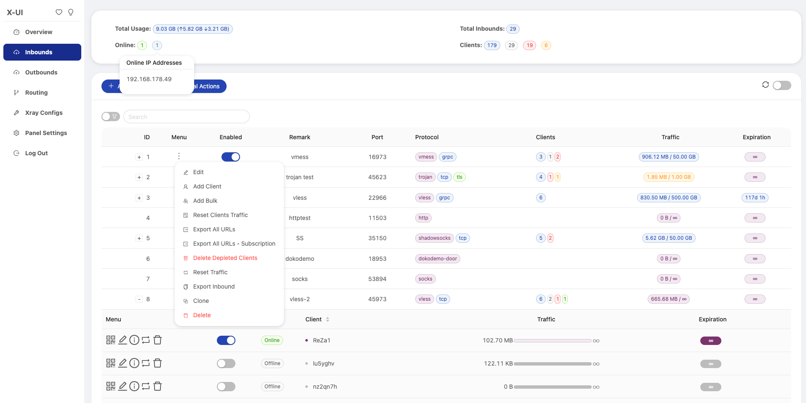
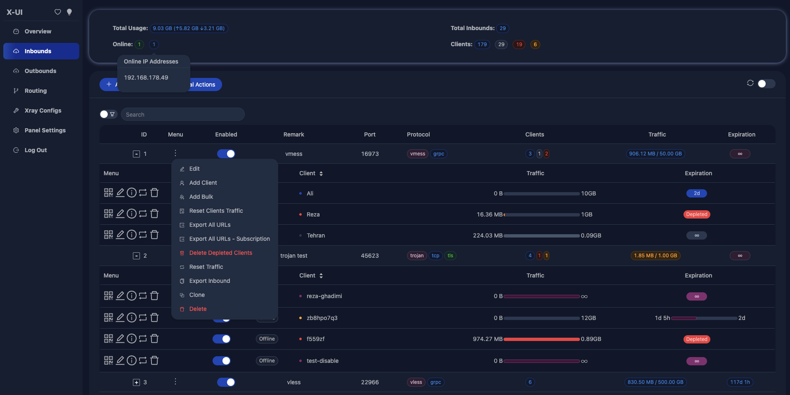
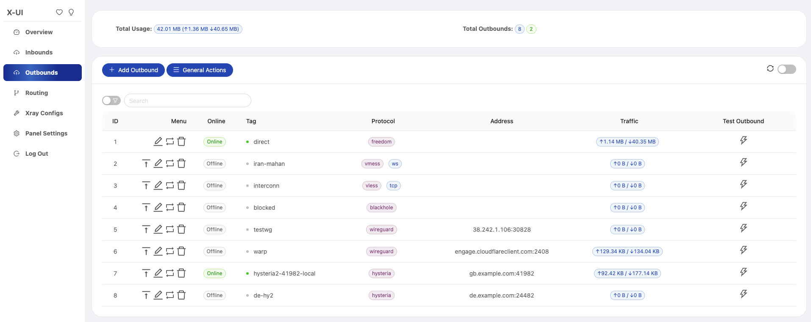
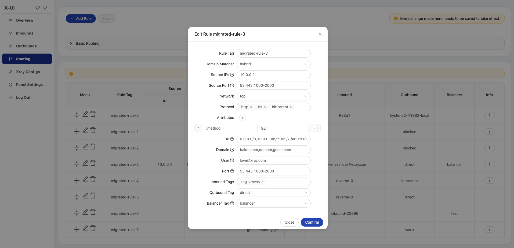
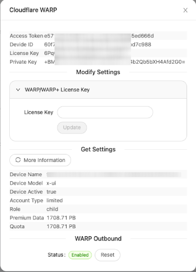

# x-ui-m

本项目修改自 [alireza0/x-ui](https://github.com/alireza0/x-ui)，保留原项目的 GPL-3.0 许可证及相关版权声明。部署使用本目录构建的产物；当前目录不包含原仓库的 Git 历史或远程地址。

`.github/workflows/release.yml.disabled` 是暂时停用的上游发布工作流。托管到 GitHub 前，需要按本项目的构建、发布和镜像配置重新审查，不能直接当成本项目的发布流程启用。请勿提交数据库、证书、隧道令牌或部署凭据。

# X-UI
**An Advanced Web Panel • Built on Xray Core**


[](https://goreportcard.com/report/github.com/alireza0/x-ui)
[](https://img.shields.io/github/downloads/alireza0/x-ui/total.svg)
[](https://www.gnu.org/licenses/gpl-3.0.en.html)

> **Disclaimer:** This project is only for personal learning and communication, please do not use it for illegal purposes, please do not use it in a production environment

**If you think this project is helpful to you, you may wish to give a**:star2: **or donate me a coffee:**

**Official Donation Page:** [https://donate.alireza0.dev/](https://donate.alireza0.dev/)

[](https://www.buymeacoffee.com/alireza7)
<a href="https://nowpayments.io/donation/alireza7" target="_blank" rel="noreferrer noopener">
   
</a>

## Quick Overview
| Features                               |      Enable?       |
| -------------------------------------- | :----------------: |
| Multi-Protocol                         | :heavy_check_mark: |
| Multi-Language                         | :heavy_check_mark: |
| Multi-Client/Inbound                   | :heavy_check_mark: |
| Advanced Traffic Routing Interface     | :heavy_check_mark: |
| Client & Traffic & System Status       | :heavy_check_mark: |
| Date & Traffic Cap Based on First Use  | :heavy_check_mark: |
| REST API                               | :heavy_check_mark: |
| TG Bot (DB backup + admin + client)    | :heavy_check_mark: |
| Subscription Service (link + info)     | :heavy_check_mark: |
| Search in Deep                         | :heavy_check_mark: |
| Dark/Light Theme                       | :heavy_check_mark: |
| IP Limit per client (Linux Only)       | :heavy_check_mark:* |
  
## 从当前源码构建与部署

本目录基于 alireza0/x-ui 修改。上游发布包和 `alireza7/x-ui` 镜像不包含这里的适配。仓库继承的 `install.sh` 只下载上游版本，默认已阻止运行；管理脚本中的安装和更新入口也不会自动下载上游面板。

在本目录构建并运行本地镜像：

```sh
docker compose up -d --build
```

Compose 使用当前目录的 Dockerfile，数据库保存在 `./db/`，证书目录为 `./cert/`。使用主机网络和 `NET_ADMIN` 是为了支持原面板的 IP 限制及可选的 UDP 端口跳跃；使用前请确认服务器网络规则和权限符合需求。配置了 Hysteria2 端口跳跃后，可在面板手动同步，或设置 `XUI_PORTHOP_AUTO=1` 开启自动同步，详见 [PORTHOP.md](PORTHOP.md)。

Cloudflare Tunnel 需要容器中可执行的 `cloudflared`。可将适合目标架构的官方可执行文件只读挂载到容器，并将 `XUI_CLOUDFLARED_BINARY` 指向容器路径，详见 [CLOUDFLARE_TUNNEL.md](CLOUDFLARE_TUNNEL.md)。命名隧道还需在 Cloudflare 控制台配置。

更新源码后再次执行 `docker compose up -d --build`。升级或迁移前请先通过面板导出数据库备份；不要将上游发布包覆盖本修改版。本部署方式尚需在实际目标服务器上完成验收。

也可在 Linux 目标架构机器上生成本地二进制目录，需提前准备官方 Xray 可执行文件和包含 `geoip.dat`、`geosite.dat` 的资产目录：

```sh
bash deployment/build-local.sh /path/to/new-output /path/to/xray /path/to/assets
```

输出目录必须不存在。产物包含当前源码构建的面板、升级和备份工具、端口跳跃工具、管理脚本、systemd 服务文件和指定的 Xray 资产；打包过程不安装、启动或修改服务器服务。

构建时会生成 `MANIFEST.sha256`，安装和升级会在停止现有服务前验证包内文件。校验值只能发现文件缺失或意外修改，不能证明包的来源；请仅运行可信源码构建的包。旧构建目录没有清单时需重新构建。

已有标准路径的 systemd 安装可以使用新包里的工具进行升级：

```sh
sudo /path/to/new-output/xui-upgrade -package /path/to/new-output
```

已安装的管理命令也可执行相同的本地升级：`sudo x-ui update /path/to/new-output`。它不会下载上游发布包。

工具要求原程序位于 `/usr/local/x-ui`，原数据库位于 `/etc/x-ui/x-ui.db`，且已有 `/etc/systemd/system/x-ui.service` 和 `/usr/bin/x-ui`。升级会验证暂存的程序、停止正在运行的服务、生成数据库快照、保留旧程序及服务文件，再切换并检查服务；失败时尝试回滚。备份路径会在命令输出中显示，原先停止的服务会保持停止。升级时应停止其他可能写入该数据库的进程。

安装、升级和恢复共用同一进程锁，并发操作会被拒绝；进程退出或被终止后锁会自动释放。如果事务记录仍存在，下一次安装或升级仍需先执行恢复。

升级会保留旧目录中不属于新包的普通文件以及 `bin/*.dat` 地理数据。保留文件与旧程序目录使用硬链接，因此二者的后续修改会互相影响；需要独立副本时请另行备份。若旧目录包含符号链接、特殊文件或跨文件系统的文件，工具会拒绝或中止升级并恢复原服务。

自动升级仅接受本项目的标准 systemd 单元及其加载状态。对于运行中的服务，工具还会核对进程可执行文件、工作目录及实际环境变量。如果旧服务使用自定义单元、drop-in、环境文件、数据目录或运行用户，工具会在停止服务前拒绝升级；这些配置需要先检查并迁移，避免自动替换时丢失自定义设置或备份错误的数据库。

安装或升级期间如果进程或机器中断，后续操作会拒绝运行，直到使用同一版本的工具执行恢复：

```sh
sudo /path/to/new-output/xui-upgrade -recover
```

也可使用 `sudo x-ui recover /path/to/new-output`；即使安装目录已在中断时被移走，也应从仍然存在的构建目录运行恢复工具。

升级恢复会根据 `/var/lib/x-ui/upgrade-transaction.json` 恢复升级前的程序、服务配置及数据库快照，或清理已经提交的事务记录。恢复前会先停止服务并另存当前数据库，以保留中断后可能产生的新数据；命令会打印该快照路径，请妥善保管。全新安装恢复读取 `install-transaction.json`，核对本次安装创建的文件，另存当前数据库后清理；若文件已被替换，会停止恢复并保留现场供检查。

如果恢复命令再次中断，未能看到输出，可以在 `/var/backups/x-ui/xui-db-*` 目录中查找数据库快照。`x-ui.db` 是通过完整性检查并完成文件同步的快照；`.x-ui.db.partial` 是尚未完成发布的临时文件，不应作为完成的备份使用。升级恢复保存的快照路径也会记录在对应旧安装备份目录的 `interrupted-snapshot-*.path` 文件中；全新安装恢复的路径记录位于快照目录内。备份可能包含敏感数据，应限制访问并在确认不再需要后清理。

生成快照时，如果 SQLite 检测到中断后遗留的回滚日志，工具会以读写方式打开已有数据库，让 SQLite 先恢复未完成的事务，再生成快照；它不会创建缺失的源数据库。

全新安装会拒绝覆盖已有的数据库及其 `-wal`、`-shm`、`-journal` 附属文件。恢复时若数据库缺失但附属文件仍存在，工具会保留现场并要求人工检查。

全新安装的服务若已经尝试启动，回滚或中断恢复会保留其程序目录，路径以 `.x-ui-failed-` 开头；初始凭据会保存在额外数据库快照同目录的 `initial-credentials` 文件中。这些文件可能包含敏感信息，确认不再需要后可自行清理。

升级事务会记录原数据库快照的 SHA-256，恢复或回滚前会重新核对；快照不匹配、缺少校验值或不可读取时会停止自动恢复并保留现场。较早版本遗留的、没有校验值的未完成升级事务需要手动检查。

恢复还会核对旧安装目录的文件系统身份、新安装目录的事务标记，以及旧 systemd 单元和管理命令的校验值。如果目录或备份文件被替换，恢复会停止。回滚时新程序目录会保留在 `.x-ui-failed-*` 目录中，并在命令输出中提示其位置；确认不再需要后可自行清理。

启动后的健康检查会读取本地数据库设置，通过面板登录并确认 Xray 处于运行状态。监听地址必须是本机 IP 或 `localhost`；HTTPS 使用面板配置的证书文件固定服务端证书。检查失败会触发回滚。健康检查会产生一次面板登录记录。升级前服务若处于停止状态，升级不会启动它或执行启动后健康检查；下次启动时需自行确认服务正常。

升级已经切换后若发生回滚，原本运行的服务恢复启动后也会执行同样的健康检查；检查失败会保留事务记录，修复服务后可再次运行恢复命令。

如果新服务已经尝试启动，回滚前也会额外保存它运行期间的数据库状态；备份失败时会停止自动回滚并保留事务记录，以免覆盖尚未保存的数据。

全新安装可使用：

```sh
sudo /path/to/new-output/xui-upgrade -install -package /path/to/new-output -port 2053
sudo cat /etc/x-ui/initial-credentials
```

在源码目录也可以使用 `sudo bash install.sh --local /path/to/new-output 2053`；该入口调用同一套本地安装事务。

工具会拒绝覆盖现有安装、数据库、管理命令或同名 systemd 服务；它创建随机用户名、密码和面板路径，将凭据存放在权限为 `0600` 的文件中，并启用和启动服务。请保存凭据后删除该文件。若端口已占用，指定其他端口。

安装、升级和故障回滚已在隔离目录、真实用户级 systemd 及 Debian 12 KVM 系统级 systemd 中验证。系统级测试覆盖了安装、重启自动启动、运行中和停止状态升级、自定义文件保留、脚本入口、端口占用、并发锁、健康检查失败回滚、进程强制终止及 SysRq 突然重启后的恢复。测试还验证了损坏快照和自定义服务配置会阻止自动操作，恢复快照及其路径记录可读取，健康检查失败时事务记录保留并可重试。

虚拟机重启测试不能代表物理机器断电或所有文件系统及存储设备的持久性；生产使用前请在目标环境验证并保留独立备份。

## Languages

- English
- Chinese
- Farsi
- Russian
- Vietnamese

## Features

- Supports protocols including VLESS, VMess, Trojan, Shadowsocks, Dokodemo-door, SOCKS, HTTP, Wireguard
- Supports XTLS protocols, including Vision and REALITY
- An advanced interface for routing traffic, incorporating PROXY Protocol, Reverse, External, and Transparent Proxy, along with Multi-Domain, SSL Certificate, and Port
- Support auto generate Cloudflare WARP using Wireguard outbound
- An interactive JSON interface for Xray template configuration
- An advanced interface for inbound and outbound configuration
- Clients’ traffic cap and expiration date based on first use
- Per-client IP limit that blocks connections beyond an allowed number of concurrent IPs (powered by nftables)
- Displays online clients, traffic statistics, and system status monitoring
- Deep database search
- Displays depleted clients with expired dates or exceeded traffic cap
- Subscription service with (multi)link
- Importing and exporting databases
- One-Click SSL certificate application and automatic renewal
- HTTPS for secure access to the web panel and subscription service (self-provided domain + SSL certificate)
- Dark/Light theme

## Preview








## API Routes

The panel publishes a full **OpenAPI 3.0 description** of its API at
`{basePath}xui/API/openapi.json`, behind the same login as the API itself. It
covers every endpoint with its parameters, request bodies and response shapes,
and a test in the repository fails the build if a route is ever added or removed
without updating it — so it cannot drift from the code.

Fetch it once you have a session cookie and open it in any OpenAPI viewer, or
point a client generator at it:

```bash
curl -c cookies.txt -X POST https://example.com:2053/mypanel/login \
  -d 'username=admin&password=secret'
curl -b cookies.txt https://example.com:2053/mypanel/xui/API/openapi.json -o openapi.json
```

The table below is a quick reference for the same endpoints.

<details>
  <summary>Click for details</summary>

### Usage

- `/login` with `PUSH` user data: `{username: '', password: ''}` for login
- `/xui/API/inbounds` base for following actions:

| Method | Path                               | Action                                    |
| :----: | ---------------------------------  | ----------------------------------------- |
| `GET`  | `"/"`                              | Get all inbounds                          |
| `GET`  | `"/get/:id"`                       | Get inbound with inbound.id               |
| `POST` | `"/add"`                           | Add inbound                               |
| `POST` | `"/del/:id"`                       | Delete inbound                            |
| `POST` | `"/update/:id"`                    | Update inbound                            |
| `POST` | `"/addClient/"`                    | Add client to inbound                     |
| `POST` | `"/:id/delClient/:clientId"`       | Delete client by clientId\*               |
| `POST` | `"/updateClient/:clientId"`        | Update client by clientId\*               |
| `GET`  | `"/getClientTraffics/:email"`      | Get client's traffic                      |
| `GET`  | `"/getClientTrafficsById/:id"`     | Get client's traffic By ID                |
| `POST` | `"/:id/resetClientTraffic/:email"` | Reset client's traffic                    |
| `POST` | `"/resetAllTraffics"`              | Reset traffics of all inbounds            |
| `POST` | `"/resetAllClientTraffics/:id"`    | Reset inbound clients traffics (-1: all)  |
| `POST` | `"/delDepletedClients/:id"`        | Delete inbound depleted clients (-1: all) |
| `POST` | `"/import"`                        | Import an inbound from exported data      |
| `POST` | `"/onlines"`                       | Get online users ( list of emails )       |


- The field `clientId` should be filled by:
  - `client.id` for VMess and VLESS
  - `client.password` for Trojan
  - `client.email` for Shadowsocks


- `/xui/API/outbounds` base for following actions:

| Method | Path                               | Action                                    |
| :----: | ---------------------------------  | ----------------------------------------- |
| `GET`  | `"/"`                              | Get all outbounds                         |
| `POST` | `"/add"`                           | Add outbound                              |
| `POST` | `"/del/:id"`                       | Delete outbound                           |
| `POST` | `"/update/:id"`                    | Update outbound                           |
| `POST` | `"/setFirst/:id"`                  | Move outbound to the top of the list      |
| `POST` | `"/:id/resetTraffic"`              | Reset outbound's traffic                  |
| `POST` | `"/resetAllTraffics"`             | Reset traffics of all outbounds           |
| `POST` | `"/onlines"`                       | Get online outbound tags                  |
| `POST` | `"/test"`                          | Test outbound connectivity                |
| `POST` | `"/reverseTags"`                   | Get client reverse tags (usable as dialer)|


- `/xui/API/routing` base for following actions:

| Method | Path                               | Action                                    |
| :----: | ---------------------------------  | ----------------------------------------- |
| `GET`  | `"/"`                              | Get all routing rules                     |
| `GET`  | `"/refs"`                          | Get routing references (tags & metadata)  |
| `POST` | `"/save"`                          | Save routing rules                        |
| `POST` | `"/replaceBalancerTag"`            | Replace a balancer tag in routing rules   |


- `/xui/API/server` base for following actions:

| Method | Path                               | Action                                    |
| :----: | ---------------------------------  | ----------------------------------------- |
| `GET`  | `"/status"`                        | Get server status                         |
| `GET`  | `"/getDb"`                         | Get database backup                       |
| `GET`  | `"/createbackup"`                  | Telegram bot sends backup to admins       |
| `GET`  | `"/getConfigJson"`                 | Get config.json                           |
| `GET`  | `"/getXrayVersion"`                | Get last xray versions                    |
| `GET`  | `"/getNewVlessEnc"`                | Get new vless enc                         |
| `GET`  | `"/getNewX25519Cert"`              | Get new x25519 cert                       |
| `GET`  | `"/getNewmldsa65"`                 | Get new mldsa65                           |
| `POST` | `"/getNewEchCert"`                 | Get new ech cert                          |
| `POST` | `"/getCertHash"`                   | Get hash for provided cert                |
| `POST` | `"/getTlsPing"`                    | Get hash by TLS ping                      |
| `POST` | `"/importDB"`                      | Import database to x-ui                   |
| `POST` | `"/stopXrayService"`               | Stop xray service                         |
| `POST` | `"/restartXrayService"`            | Restart xray service                      |
| `POST` | `"/installXray/:version"`          | Install specific version of xray          |
| `POST` | `"/logs/:count"`                   | Get panel/xray logs                       |


</details>

## Environment Variables

<details>
  <summary>Click for details</summary>

### Usage

| Variable       |                      Type                      | Default       |
| -------------- | :--------------------------------------------: | :------------ |
| XUI_LOG_LEVEL  | `"debug"` \| `"info"` \| `"warn"` \| `"error"` | `"info"`      |
| XUI_DEBUG      |                   `boolean`                    | `false`       |
| XUI_BIN_FOLDER |                    `string`                    | `"bin"`       |
| XUI_DB_FOLDER  |                    `string`                    | `"/etc/x-ui"` |

</details>

## SSL Certificate

<details>
  <summary>Click for details</summary>

### Cloudflare 

The admin management script has a built-in SSL certificate application for Cloudflare. To use this script to apply for a certificate, you need the following:

- Cloudflare registered email
- Cloudflare Global API Key
- The domain name has been resolved to the current server through cloudflare

**Step 1:** Run the`x-ui`command on the server's terminal and then choose `17`. Then enter the information as requested.


### Certbot

```bash
snap install core; snap refresh core
snap install --classic certbot
ln -s /snap/bin/certbot /usr/bin/certbot

certbot certonly --standalone --register-unsafely-without-email --non-interactive --agree-tos -d <Your Domain Name>
```

</details>

## Telegram Bot

<details>
  <summary>Click for details</summary>

### Usage

The web panel supports daily traffic, panel login, database backup, system status, client info, and other notification and functions through the Telegram Bot. To use the bot, you need to set the bot-related parameters in the panel, including:

- Telegram Token
- Admin Chat ID(s)
- Notification Time (in cron syntax)
- Database Backup
- CPU Load Threshold Notification

**Crontab Time Format**

Reference syntax:

- `*/30 * * * *` - Notify every 30 minutes, every hour
- `30 * * * * *` - Notify at the 30th second of each minute
- `0 */10 * * * *` - Notify at the start of every 10 minutes
- `@hourly` - Hourly notification
- `@daily` - Daily notification (00:00 AM)
- `@every 8h` - Notify every 8 hours

For more info about [Crontab](https://acquia.my.site.com/s/article/360004224494-Cron-time-string-format)

### Features

- Periodic reporting
- Login notifications
- CPU load threshold notifications
- Advance notifications for expiration time and traffic
- Client reporting menu with Telegram ID or username in configurations
- Anonymous traffic reports, search by UUID (VLESS/VMess) or Password (Trojan/Shadowsocks)
- Menu-based bot
- Client search by email (admin only)
- Inbound checks
- System status check
- Depleted client checks
- Backup on request and in periodic reports
- Multilingual support
</details>

## Troubleshoots

<details>
  <summary>Click for details</summary>

### Enable Traffic Usage

If you are upgrading from an older version or other forks and find that data traffic usage for clients may not work by default, follow the steps below to enable it:

**Step 1: Locate the Configuration Section**

Find the following section in the config file:

```json
  "policy": {
    "system": {
      // Other policy configurations
    }
  },
```
**Step 2: Add the Required Configuration**

Add the following section just after `"policy": {`:

```json
"levels": {
  "0": {
    "statsUserUplink": true,
    "statsUserDownlink": true
  }
},
```
**Step 3: Final Configuration**

Your final config should look like this:

```json
"policy": {
  "levels": {
    "0": {
      "statsUserUplink": true,
      "statsUserDownlink": true
    }
  },
  "system": {
    "statsInboundDownlink": true,
    "statsInboundUplink": true
  }
},
"routing": {
  // Other routing configurations
},
```
**Step 4: Save and Restart**

Save your changes and restart the Xray Service
</details>

## A Special Thanks to

- [HexaSoftwareTech](https://github.com/HexaSoftwareTech/)
- [MHSanaei](https://github.com/MHSanaei)

## Acknowledgment

- [Loyalsoldier](https://github.com/Loyalsoldier/v2ray-rules-dat) (License: **GPL-3.0**): _The enhanced version of V2Ray routing rule._
- [Iran v2ray rules](https://github.com/chocolate4u/Iran-v2ray-rules) (License: **GPL-3.0**): _Enhanced v2ray/xray and v2ray/xray-clients routing rules with built-in Iranian domains and a focus on security and adblocking._

## Star History

<a href="https://www.star-history.com/?repos=alireza0%2Fx-ui&type=date&releases=&legend=bottom-right">
 <picture>
   <source media="(prefers-color-scheme: dark)" srcset="https://api.star-history.com/chart?repos=alireza0/x-ui&type=date&theme=dark&legend=bottom-right" />
   <source media="(prefers-color-scheme: light)" srcset="https://api.star-history.com/chart?repos=alireza0/x-ui&type=date&legend=bottom-right" />
   
 </picture>
</a>
